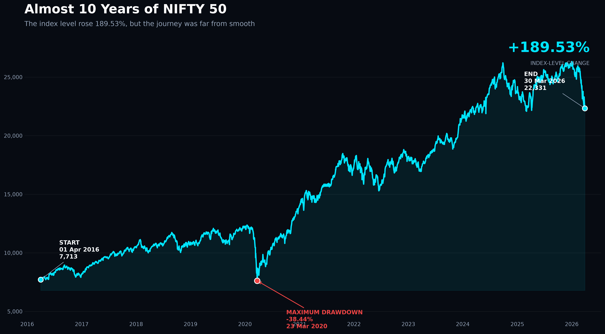
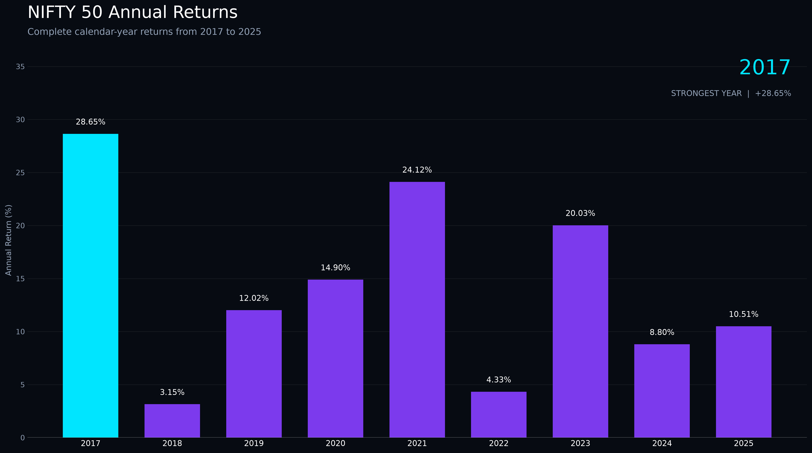
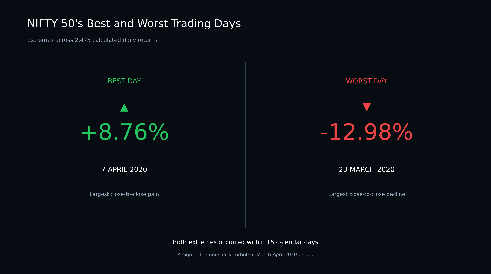
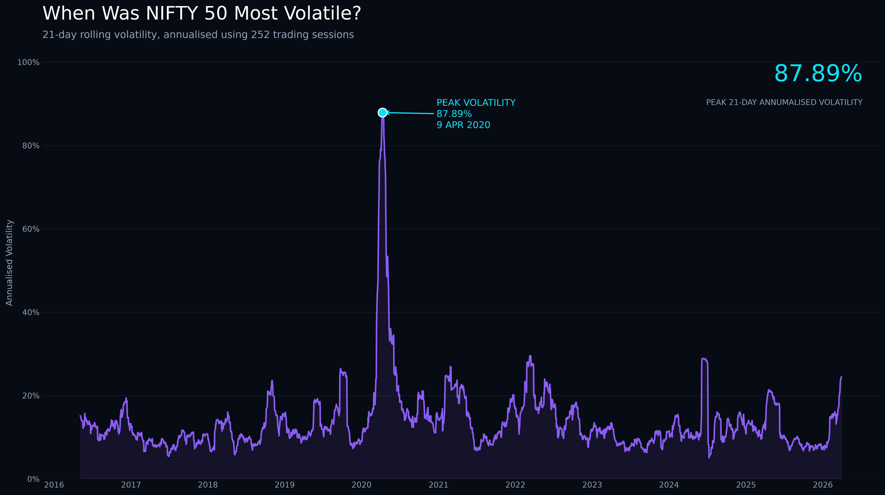
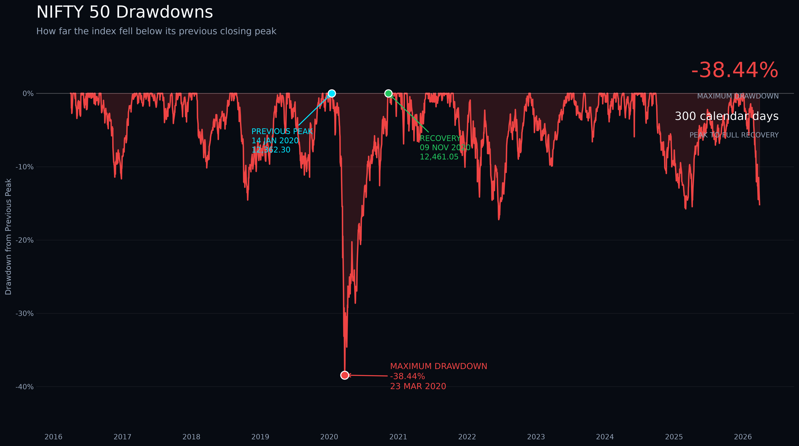
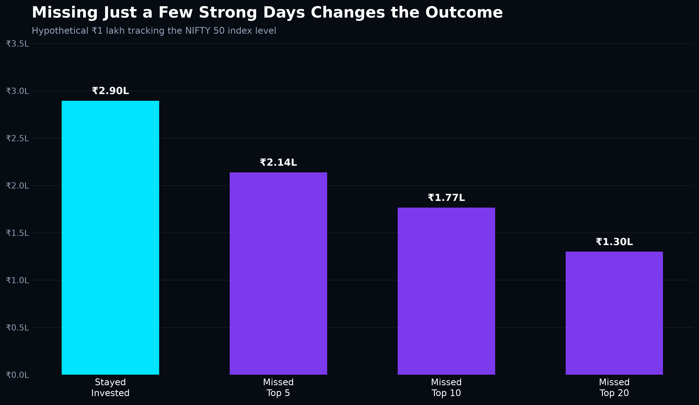

# NIFTY 50 Through a Risk Analyst's Lens
### 10 Years of Returns, Volatility, Drawdowns & Recovery (2016–2026)

A Python analysis of ten years of NIFTY 50 index data sourced directly from NSE India, covering **1 April 2016 to 30 March 2026**.

Most market summaries stop at the start and end values. This project looks at the path in between: how bumpy the ride was, how far the index fell from its highs, how long recovery took, and how much of the long-term growth came from a handful of days.

---

## Key Findings at a Glance

| Metric | Result |
|---|---|
| Index level | **7,713 → 22,331** |
| Index-level change | **+189.53%** |
| CAGR | **11.22%** |
| Hypothetical ₹1 lakh | **₹2,89,527** |
| Maximum drawdown | **−38.44%** (14 Jan 2020 → 23 Mar 2020) |
| Peak-to-full-recovery | **300 calendar days** |
| Peak 21-day annualised volatility | **87.89%** (9 Apr 2020) |
| Worst trading day | **−12.98%** on 23 Mar 2020 |
| Best trading day | **+8.76%** on 7 Apr 2020 |
| Strongest complete calendar year | **2017: +28.65%** |
| Weakest complete calendar year | **2018: +3.15%** |

**The most interesting pattern:** the best and worst days were not spread evenly across the decade. Seven of the ten strongest days occurred between March and April 2020, the same weeks that produced the worst day and the maximum drawdown. Extreme gains and extreme losses arrived together.

---

## Questions Explored

1. How did the NIFTY 50 index level change over the period?
2. Which complete calendar years were strongest and weakest?
3. How did daily returns behave, and what were the most extreme trading days?
4. When was market volatility highest?
5. What was the maximum drawdown, and how long did it take to recover?
6. What would a hypothetical ₹1 lakh tracking the index level have become?
7. How would that outcome change if the strongest trading days were missed?

---

## Data Source

Historical NIFTY 50 index data downloaded from the **Historical Index Data** section of [NSE India](https://www.nseindia.com/).

- **Period:** 1 April 2016 – 30 March 2026
- **Observations:** 2,476 trading days (2,475 daily returns)
- **Raw format:** 10 CSV files, one per financial year (April–March)
- **Fields:** Date, Open, High, Low, Close, Shares Traded, Turnover (₹ Cr)

The original files are preserved unchanged in `data/raw/`. The combined, cleaned dataset is saved to `data/processed/nifty50_clean.csv`.

---

## Methodology

### 1. Data preparation and validation
- Confirmed all 10 files share an identical column structure before combining
- Stripped trailing spaces from NSE column names (e.g. `'Close '` → `'Close'`)
- Converted dates and sorted chronologically (NSE files are stored newest-first)
- Checked for invalid dates, duplicate dates, missing values and OHLC consistency (High ≥ Low): **none found**

### 2. Analysis

| Analysis | Method |
|---|---|
| Daily returns | `Close.pct_change()` |
| Annual returns | Year-end close to year-end close; partial years (2016, 2026) excluded |
| Volatility | 21-day rolling standard deviation of daily returns, annualised with √252 |
| Drawdown | `Close / running peak − 1`, with peak, bottom and recovery dates identified |
| ₹1 lakh simulation | ₹1,00,000 scaled by the index-level change |
| CAGR | `(ending / starting value)^(1 / years) − 1`, over 9.99 years |
| Missed-strongest-days | The N largest daily returns replaced with 0%, remaining returns compounded |

---

## Results

### The 10-year journey


### Annual returns


Every complete calendar year from 2017 to 2025 ended positive. The 2020 crash was severe, but the index recovered within the same calendar year and finished 2020 up 14.90%.

### Best vs worst trading day


### Rolling volatility


Volatility peaked at **87.89%** (21-day annualised) on 9 April 2020. This is a short-window, crisis-period reading, not a typical level. Across the full period, the standard deviation of daily returns was about **1.02%**.

### Drawdowns and recovery


| Stage | Date | NIFTY 50 Close | Duration |
|---|---|---|---|
| Peak | 14 Jan 2020 | 12,362.30 | — |
| Bottom | 23 Mar 2020 | 7,610.25 | 69 days from peak |
| Recovery | 9 Nov 2020 | 12,461.05 | 231 days from bottom |
| **Total** | | | **300 calendar days** |

### Missing the strongest days


| Scenario | Ending Hypothetical Value |
|---|---:|
| Stayed invested | **₹2,89,527** |
| Missed strongest 5 days | ₹2,13,845 |
| Missed strongest 10 days | ₹1,76,631 |
| Missed strongest 20 days | ₹1,29,953 |

Missing just the 10 strongest days out of 2,475 cut the ending value by about 39%. Because most of those days fell inside the 2020 crash, avoiding them in practice would have meant being out of the market during its most frightening weeks.

> This is a hindsight-based counterfactual, not an investment strategy. No one can identify the strongest days in advance.

---

## Limitations

- **Price index, not total return.** The NIFTY 50 price index excludes dividends, so all return figures understate what an investor holding the constituent stocks would have earned. The NIFTY 50 Total Return Index (TRI) would show higher growth.
- **Not directly investable.** NIFTY 50 is an index. The ₹1 lakh figure tracks index-level movement, not the realised return of an index fund or ETF.
- **No costs included.** Taxes, transaction costs, fund expense ratios and tracking error are not modelled.
- **Hindsight in the counterfactual.** The missed-strongest-days analysis identifies the best days after the fact.
- **Partial years.** 2016 (from April) and 2026 (to 30 March) are excluded from the calendar-year comparison.
- **Calendar-day durations.** Drawdown and recovery periods are measured in calendar days, not trading days.

---

## Next Steps

Planned extensions to deepen the risk analysis:

- **Drawdown table:** every decline of 10% or more, with depth, duration and recovery time
- **Value at Risk (VaR) and Expected Shortfall** at 95% and 99% confidence
- **Tail risk:** how often extreme moves occurred compared with a normal distribution
- **Missed-worst-days scenario:** to show that the best and worst days arrive together
- **Data extension:** updating the dataset beyond March 2026

---

## Project Structure

```
nifty50-analysis/
├── data/
│   ├── raw/                  # Original NSE yearly CSV files
│   └── processed/            # Combined, cleaned dataset
├── notebooks/
│   └── nifty50_analysis.ipynb
├── visuals/                  # Exported charts (PNG)
├── src/
├── requirements.txt
└── README.md
```

---

## How to Run

```bash
git clone https://github.com/RoshniPandey18/nifty50-analysis.git
cd nifty50-analysis
pip install -r requirements.txt
jupyter notebook notebooks/nifty50_analysis.ipynb
```

Run the notebook from the `notebooks/` folder so the relative paths (`../data/`, `../visuals/`) resolve correctly.

**Tools:** Python · Pandas · NumPy · Matplotlib · Seaborn · Jupyter · VS Code

---

## Author

**Roshni Pandey**, Data & Risk Analytics Consultant

Building real AI and data projects around risk and finance, and documenting how they work.

---

*Disclaimer: This project is for educational purposes only and does not constitute investment advice.*
